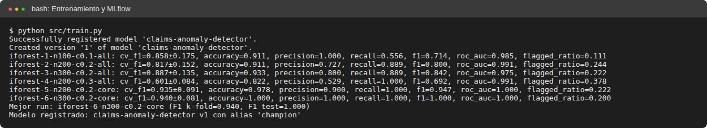
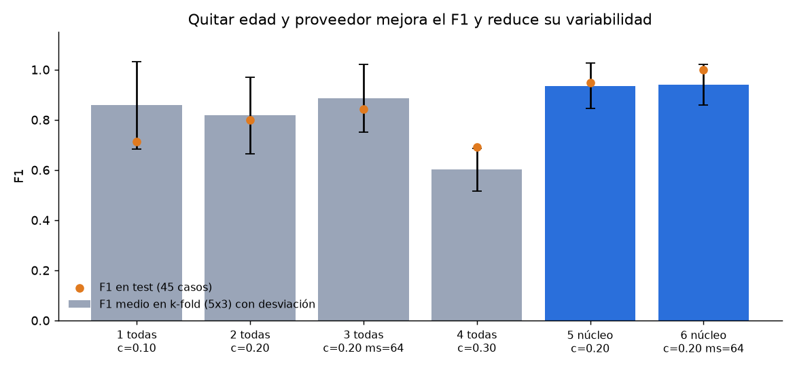
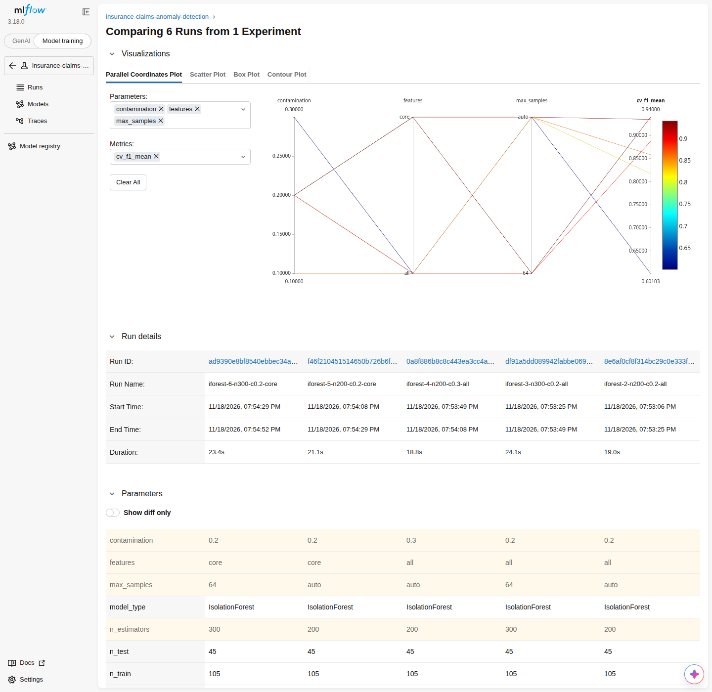
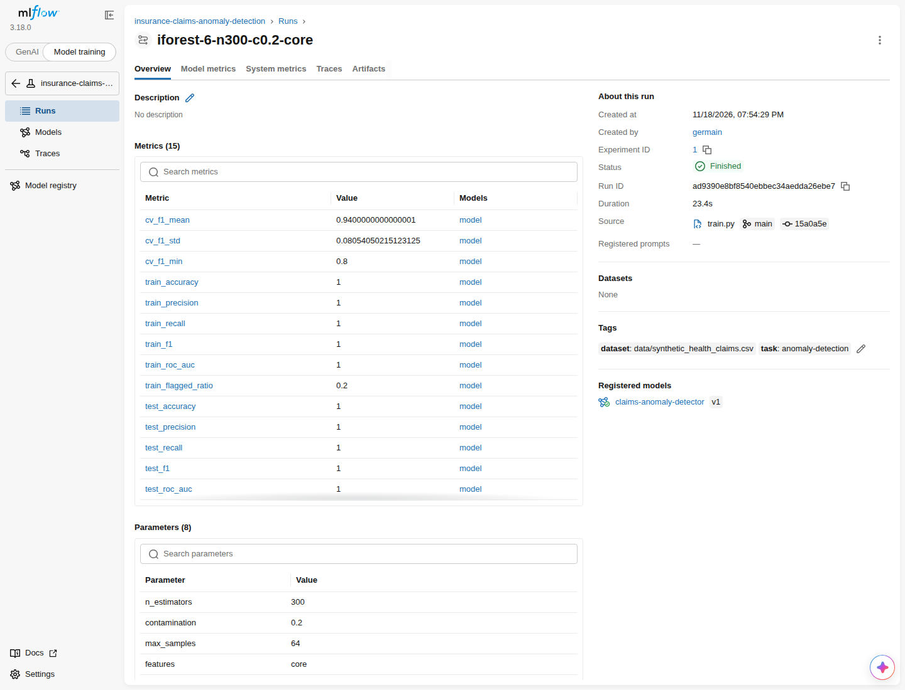
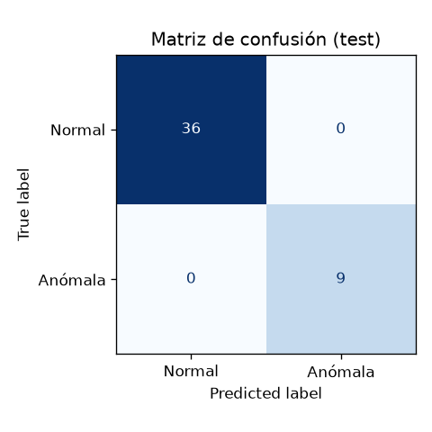
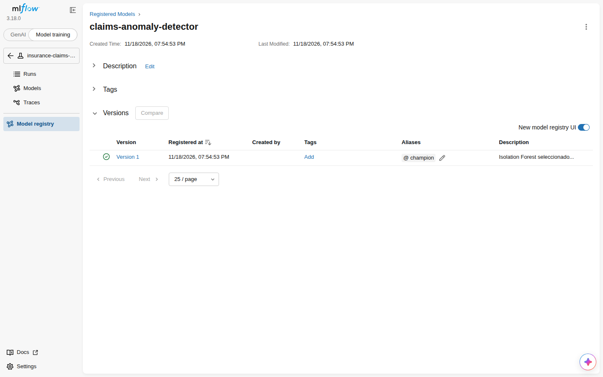

# Pipeline de Machine Learning de extremo a extremo

## Detección de reclamaciones de seguros que requieren revisión adicional

**Grupo:** Ricardo Acuña, César Pajuelo, Angello Soldi, Josué Velo, Paolo Medrano.

**Herramientas:** Python 3.12, scikit learn (Isolation Forest), MLflow 3.18 (seguimiento de experimentos y registro de modelos) y BentoML 1.4 (servicio de predicción).

## 1. Contexto y objetivo

En el procesamiento tradicional de reclamaciones de seguros, cada solicitud llega por un portal, se acumula como documentación enviada y pasa por un comité de evaluación. Desde allí se deriva a revisión de reclamaciones o al equipo de investigación, y solo al final se aprueba y se paga. Todo el flujo es manual, de modo que el comité dedica el mismo esfuerzo a una reclamación rutinaria que a una sospechosa.


La propuesta es insertar un modelo de Machine Learning justo antes del comité de evaluación. El servicio:

1. **carga** reclamaciones, una a una en JSON o en lote mediante un archivo CSV;
2. las **analiza** con un modelo de detección de anomalías;
3. **identifica** las que requieren revisión adicional y aprueba automáticamente las demás.

Así, el comité y el equipo de investigación se concentran en los casos atípicos. Como en producción no hay etiquetas fiables de fraude o error, el problema se plantea como detección de anomalías no supervisada con Isolation Forest. La etiqueta sintética is_anomaly solo se usa para evaluar, nunca para entrenar.

### Arquitectura

| Etapa | Componente | Función |
|---|---|---|
| Desarrollo | generate_data.py y train.py | Generar datos, entrenar y evaluar |
| Experimentos | Servidor MLflow (puerto 5001) | Guardar parámetros, métricas, gráficos y modelos de cada run |
| Registro | MLflow Model Registry | Versionar el modelo y marcar el elegido con el alias champion |
| Producción | BentoML (puerto 3000) | Exponer la API de predicción y empaquetar el servicio |

### Estructura del proyecto

```
Practica04/
├── data/                      datos sintéticos y reclamaciones nuevas de prueba
├── src/generate_data.py       generación de datos (código del enunciado)
├── src/train.py               entrenamiento, validación, seguimiento y registro
├── src/import_to_bentoml.py   paso del modelo champion de MLflow a BentoML
├── src/service.py             servicio BentoML
├── bentofile.yaml             definición del Bento
├── capturas/                  capturas del informe
└── presentacion/              presentación en HTML y PPTX
```

## 2. Preparación del entorno

```bash
python3 -m venv .venv
source .venv/bin/activate
pip install -r requirements.txt
```

| Paquete | Versión |
|---|---|
| mlflow | 3.18.0 |
| bentoml | 1.4.40 |
| scikit learn | 1.9.1 |
| pandas | 3.1.1 |
| numpy | 2.4.6 |

## 3. Generación de datos sintéticos

Se usa el script del enunciado sin cambios; solo se cambia la ruta de salida a la carpeta data.

```bash
python src/generate_data.py
```


El conjunto tiene 150 reclamaciones: 120 normales y 30 anómalas (20 %). Al leer cómo se generan, se observa algo clave para el modelado:

| Variable | Normales | Anómalas | ¿Separa las clases? |
|---|---|---|---|
| claim_amount | 100 a 3 000 | 8 000 a 25 000 | Sí, sin solapamiento |
| num_services | 1 a 5 | 8 a 19 | Sí |
| days_since_last_claim | 30 a 364 | 0 a 14 | Sí |
| patient_age | 18 a 84 | 18 a 84 | No, misma distribución |
| provider_id | P001 a P005 | P001 a P005 | No, misma distribución |

La anomalía está en tres variables. La edad y el proveedor se generan igual en ambas clases, así que para el modelo son ruido. El identificador claim_id nunca se usa como variable.

## 4. Servidor MLflow

El servidor usa SQLite para guardar experimentos, runs y el registro de modelos, y una carpeta local para los artefactos:

```bash
mlflow server --backend-store-uri sqlite:///mlflow.db \
  --artifacts-destination ./mlartifacts --host 127.0.0.1 --port 5001
```

La interfaz queda disponible en http://127.0.0.1:5001 y la comprobación de salud responde OK.

## 5. Entrenamiento y evaluación del modelo

### 5.1 Pipeline

El preprocesamiento va dentro de un Pipeline de scikit learn junto con el Isolation Forest. Así, el modelo registrado recibe los datos crudos y no hay diferencias de preparación entre entrenamiento y producción. Las variables numéricas se estandarizan y, cuando se usa el proveedor, este se codifica en variables indicadoras.

### 5.2 Metodología

1. División estratificada 70/30: 105 reclamaciones para entrenamiento y 45 para prueba.
2. El modelo se ajusta sin etiquetas (aprendizaje no supervisado).
3. **Validación cruzada estratificada repetida** sobre el entrenamiento: 5 particiones repetidas 3 veces (15 ajustes por configuración). Su F1 medio es el criterio para elegir el modelo, de modo que el conjunto de prueba no interviene en la selección y se reserva para una evaluación final honesta.
4. Métricas: accuracy, precision, recall, F1, ROC AUC y proporción de casos marcados.
5. Cada run registra en MLflow los parámetros, las métricas de validación cruzada, entrenamiento y prueba, la matriz de confusión y el modelo con su firma y ejemplo de entrada.

Se comparan seis configuraciones. Las cuatro primeras usan todas las variables y las dos últimas solo el núcleo informativo (monto, servicios y días desde la última reclamación):

| Run | Variables | n_estimators | contamination | max_samples |
|---|---|---|---|---|
| 1 | todas | 100 | 0.10 | auto |
| 2 | todas | 200 | 0.20 | auto |
| 3 | todas | 300 | 0.20 | 64 |
| 4 | todas | 200 | 0.30 | auto |
| 5 | núcleo | 200 | 0.20 | auto |
| 6 | núcleo | 300 | 0.20 | 64 |

```bash
python src/train.py
```



### 5.3 Resultados

| Run | F1 validación cruzada | Desviación | F1 prueba | Precision | Recall | ROC AUC | % marcado |
|---|---|---|---|---|---|---|---|
| 1 | 0.858 | 0.175 | 0.714 | 1.000 | 0.556 | 0.985 | 11.1 % |
| 2 | 0.817 | 0.152 | 0.800 | 0.727 | 0.889 | 0.991 | 24.4 % |
| 3 | 0.887 | 0.135 | 0.842 | 0.800 | 0.889 | 0.975 | 22.2 % |
| 4 | 0.601 | 0.084 | 0.692 | 0.529 | 1.000 | 0.991 | 37.8 % |
| 5 | 0.935 | 0.091 | 0.947 | 0.900 | 1.000 | 1.000 | 22.2 % |
| **6** | **0.940** | **0.081** | **1.000** | **1.000** | **1.000** | **1.000** | **20.0 %** |



**Interpretación:**

1. **La selección de variables pesa más que los hiperparámetros.** Con las mismas configuraciones, quitar edad y proveedor sube el F1 de validación de 0.887 a 0.940 y reduce la desviación de 0.135 a 0.081. Isolation Forest aísla puntos con cortes aleatorios; cada variable sin señal consume cortes que no ayudan a separar lo anómalo, y las variables indicadoras del proveedor agregan cinco dimensiones de ruido.
2. **El umbral es una decisión de negocio.** El parámetro contamination fija qué fracción se envía a revisión. Con 0.10 no hay falsas alarmas, pero se escapa casi la mitad de las anomalías; con 0.30 se detectan todas, pero casi la mitad de las alertas son falsas y aumenta la carga del comité. Un valor cercano a la tasa real (20 %) da el mejor equilibrio.
3. **¿El F1 de 1.0 es sobreajuste?** No. El run 6 obtiene 1.0 de F1 en entrenamiento frente a 0.940 en validación cruzada: la brecha es pequeña y el peor de los 15 pliegues llega a 0.80. El 1.0 en prueba se debe a que 45 casos son pocos y esa partición resultó favorable; la estimación realista es 0.94. Además, el modelo no ve etiquetas al entrenar, por lo que no puede memorizarlas.
4. **El ROC AUC de 1.0 refleja los datos, no el modelo.** Los montos normales y anómalos no se solapan, así que el puntaje de anomalía los ordena perfectamente. Con datos reales, donde las clases se mezclan, se esperan valores menores.

### 5.4 Interfaz de MLflow

Runs del experimento insurance claims anomaly detection:


Comparación de los seis runs con el gráfico de coordenadas paralelas. Las líneas que pasan por el núcleo de variables terminan en los valores más altos de F1:



Detalle del run elegido, con las métricas de validación cruzada y el modelo registrado asociado:



Matriz de confusión del run 6 en el conjunto de prueba: 36 verdaderos negativos, 9 verdaderos positivos y ningún error.



## 6. Registro del modelo

Al final de train.py se elige el run con mayor F1 en validación cruzada, se registra en el Model Registry y se le asigna el alias champion:

```python
mv = mlflow.register_model(f"runs:/{best_run_id}/model", MODEL_NAME)
client.set_registered_model_alias(MODEL_NAME, "champion", mv.version)
```

El alias reemplaza a los antiguos estados de MLflow. El servicio siempre apunta al modelo champion y no a un número de versión, por lo que promover un modelo nuevo consiste en reasignar el alias.



**Nota técnica:** MLflow 3.18 serializa los modelos de scikit learn con skops y exige declarar los tipos de confianza. Como el modelo lo entrenamos nosotros, se declara como confiable el tipo de árbol interno de scikit learn.

## 7. Servicio con BentoML

### 7.1 Importación y empaquetado

import_to_bentoml.py copia el modelo champion del registro de MLflow al almacén de modelos de BentoML. Luego se construye el Bento definido en bentofile.yaml:

```bash
python src/import_to_bentoml.py
bentoml build
```


El Bento resultante puede convertirse en contenedor Docker con bentoml containerize para desplegarlo en cualquier infraestructura.

### 7.2 Definición del servicio

El servicio ClaimsReviewService ofrece tres puntos de acceso:

1. **predict:** recibe una lista de reclamaciones en JSON.
2. **upload_csv:** recibe un archivo CSV para la carga masiva.
3. **health_check:** informa el estado y la versión del modelo.

Antes de llegar al modelo, Pydantic valida cada reclamación: monto mayor que cero, al menos un servicio, edad entre 0 y 120 y proveedor dentro del catálogo. Para cada caso se devuelve el puntaje de anomalía (más alto significa más atípico), la marca de anomalía y la decisión: revisión manual o aprobación automática.

```bash
bentoml serve src.service:ClaimsReviewService --port 3000
```


## 8. Pruebas del servicio

### 8.1 Carga masiva por CSV

El archivo data/new_claims.csv contiene seis reclamaciones que el modelo no vio durante el entrenamiento.


| Reclamación | Monto | Servicios | Días desde la última | Puntaje | Decisión |
|---|---|---|---|---|---|
| CLM 9001 | 850 | 2 | 180 | −0.090 | Aprobación automática |
| CLM 9002 | 15 400 | 12 | 3 | 0.022 | **Revisión manual** |
| CLM 9003 | 2 200 | 4 | 95 | −0.096 | Aprobación automática |
| CLM 9004 | 21 000 | 17 | 1 | 0.089 | **Revisión manual** |
| CLM 9005 | 450 | 1 | 300 | −0.034 | Aprobación automática |
| CLM 9006 | 9 800 | 9 | 10 | 0.031 | **Revisión manual** |

El modelo deriva a revisión exactamente las reclamaciones que combinan monto alto, muchos servicios y poco tiempo desde la anterior. El puntaje además permite ordenar la cola: CLM 9004 es la más urgente. Con el modelo mejorado, los casos normales quedan más lejos del umbral (puntajes cercanos a −0.09 frente a −0.06 del modelo anterior), lo que da decisiones más estables.

### 8.2 Predicción en JSON

```bash
curl -X POST localhost:3000/predict -H 'Content-Type: application/json' -d '{"claims": [
 {"claim_id":"CLM-9101","claim_amount":1250.5,"num_services":2,"patient_age":45,"provider_id":"P001","days_since_last_claim":120},
 {"claim_id":"CLM-9102","claim_amount":18000,"num_services":14,"patient_age":67,"provider_id":"P004","days_since_last_claim":2}]}'
```

```json
{"total_claims":2,"flagged_for_review":1,"auto_approved":1,"results":[
 {"claim_id":"CLM-9101","anomaly_score":-0.0799,"is_anomaly":false,"decision":"APROBACIÓN AUTOMÁTICA"},
 {"claim_id":"CLM-9102","anomaly_score":0.0437,"is_anomaly":true,"decision":"REVISIÓN MANUAL"}]}
```

### 8.3 Entradas inválidas

Una reclamación con monto negativo, cero servicios y un proveedor inexistente se rechaza antes de llegar al modelo, con tres errores de validación que indican el campo y la regla incumplida. Esto evita que datos corruptos generen decisiones automáticas.

## 9. Conclusiones

1. Se construyó un pipeline completo y reproducible: datos, experimentos con seguimiento en MLflow, registro versionado con alias y servicio de predicción con BentoML.
2. La mejora más importante fue eliminar las variables sin señal. El F1 estimado por validación cruzada pasó de 0.887 a 0.940, con menor variabilidad.
3. Elegir el modelo con validación cruzada, y no con el conjunto de prueba, evita estimaciones optimistas y permite descartar el sobreajuste con evidencia.
4. El umbral de contaminación es una decisión de negocio: más recall significa menos fraude que se escapa y más precisión significa menos carga para el comité.
5. Gracias al alias champion, actualizar el modelo en producción no requiere cambiar el código del servicio.

**Trabajo futuro:** validar con datos reales donde las clases se solapen, explicar cada alerta para el revisor, monitorear la deriva de las variables en producción y desplegar el Bento en contenedor.

## Anexo: comandos para reproducir

```bash
source .venv/bin/activate
python src/generate_data.py
mlflow server --backend-store-uri sqlite:///mlflow.db --artifacts-destination ./mlartifacts --host 127.0.0.1 --port 5001 &
python src/train.py
python src/import_to_bentoml.py
bentoml serve src.service:ClaimsReviewService --port 3000 &
curl -X POST localhost:3000/upload_csv -F file=@data/new_claims.csv
bentoml build
```
