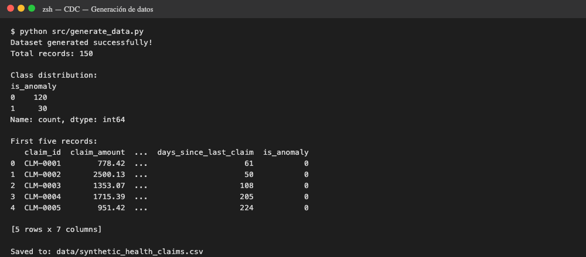
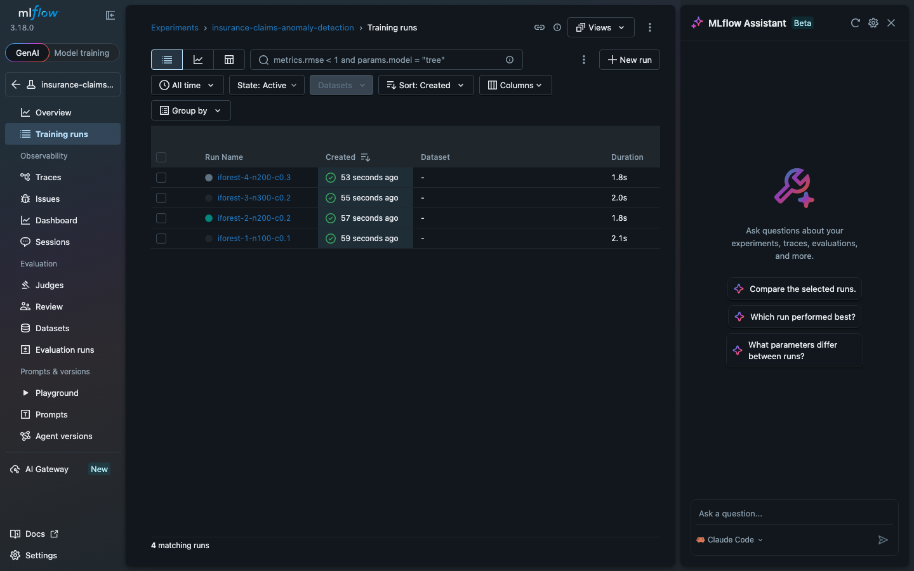
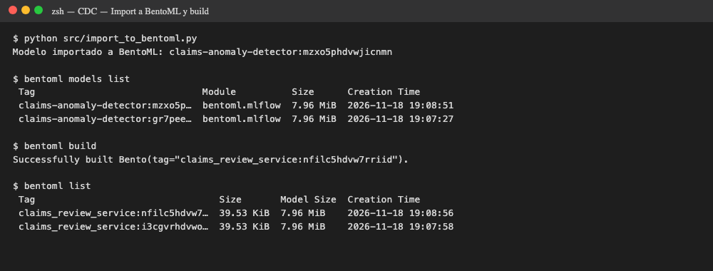
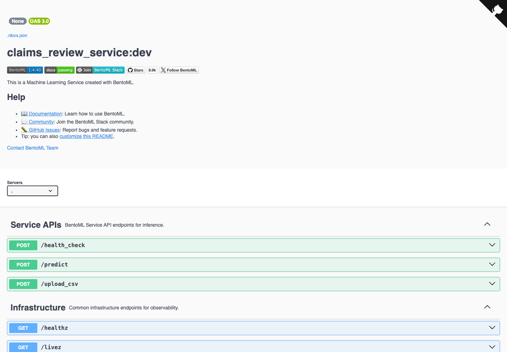
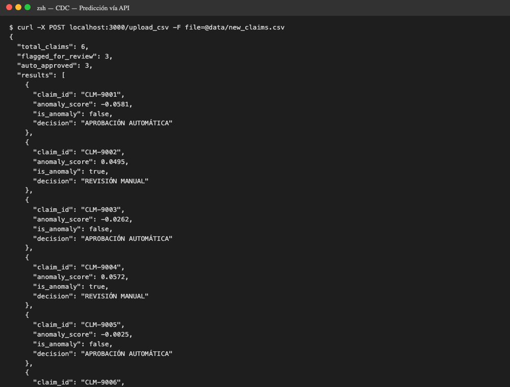

# Pipeline de Machine Learning de extremo a extremo
## Detección de reclamaciones de seguros que requieren revisión adicional

**Herramientas:** Python 3.11 · scikit-learn (Isolation Forest) · MLflow 3.18 (tracking y Model Registry) · BentoML 1.4 (serving)

---

## 1. Contexto y objetivo

En el procesamiento tradicional de reclamaciones de seguros, cada reclamación pasa por un flujo de revisión y aprobación documental que en su mayor parte es manual. El objetivo de esta práctica es construir un servicio que:

1. **cargue** reclamaciones (una a una en JSON o en lote mediante un CSV),
2. las **analice** con un modelo de Machine Learning, y
3. **identifique** las que necesitan revisión manual, aprobando automáticamente las demás.

Como no tenemos etiquetas fiables en producción, el problema se plantea como **detección de anomalías no supervisada** con **Isolation Forest**. Las etiquetas sintéticas (`is_anomaly`) se usan solo para evaluar el modelo, nunca para entrenarlo.

### Arquitectura

```
 ┌──────────────────┐     ┌──────────────────────────────┐     ┌───────────────────────┐
 │  Desarrollo      │     │  MLflow Tracking Server      │     │  BentoML              │
 │  generate_data.py│ ──▶ │  · Experimento + 4 runs      │ ──▶ │  · Model Store        │
 │  train.py        │     │  · Métricas / artefactos     │     │  · ClaimsReviewService│
 │                  │     │  · Model Registry @champion  │     │  · API REST :3000     │
 └──────────────────┘     └──────────────────────────────┘     └───────────────────────┘
        datos                  backend: sqlite (mlflow.db)          /predict
   synthetic_health_         artefactos: ./mlartifacts              /upload_csv
      claims.csv                                                    /health_check
```

### Estructura del proyecto

```
CDC/
├── data/
│   ├── synthetic_health_claims.csv   # dataset generado (150 registros)
│   └── new_claims.csv                # reclamaciones nuevas para probar el servicio
├── src/
│   ├── generate_data.py              # generación de datos sintéticos (código del enunciado)
│   ├── train.py                      # entrenamiento, evaluación, tracking y registro
│   ├── import_to_bentoml.py          # MLflow Registry ➜ BentoML Model Store
│   └── service.py                    # servicio BentoML
├── bentofile.yaml                    # definición del Bento
├── requirements.txt
├── capturas/                         # capturas de este informe
├── mlflow.db / mlartifacts/          # backend y artefactos de MLflow
└── INFORME.md
```

---

## 2. Preparación del entorno

```bash
cd ~/Desktop/CDC
uv venv .venv --python 3.11          # (o: python3 -m venv .venv)
source .venv/bin/activate
uv pip install -r requirements.txt   # mlflow, bentoml, scikit-learn, pandas, numpy, matplotlib
```

| Paquete | Versión |
|---|---|
| mlflow | 3.18.0 |
| bentoml | 1.4.40 |
| scikit-learn | 1.9.1 |
| pandas | 3.1.1 |
| numpy | 2.4.6 |

---

## 3. Generación de datos sintéticos

Se usa el script del enunciado sin cambios ([src/generate_data.py](src/generate_data.py)); lo único que cambia es la ruta de salida, que pasa a `data/`. El script genera:

- **120 reclamaciones normales:** monto entre 100 y 3 000, 1–5 servicios, 30–365 días desde la última reclamación.
- **30 reclamaciones anómalas:** monto entre 8 000 y 25 000, 8–19 servicios, 0–14 días desde la última reclamación.

```bash
python src/generate_data.py
```



Variables usadas por el modelo:

| Variable | Tipo | Tratamiento |
|---|---|---|
| `claim_amount` | numérica | StandardScaler |
| `num_services` | numérica | StandardScaler |
| `patient_age` | numérica | StandardScaler |
| `days_since_last_claim` | numérica | StandardScaler |
| `provider_id` | categórica | OneHotEncoder |
| `claim_id` | identificador | no se usa como variable |
| `is_anomaly` | etiqueta | solo para evaluar |

---

## 4. Servidor MLflow

El servidor de tracking usa SQLite como *backend store* (experimentos, runs y Model Registry) y una carpeta local como *artifact store*, con proxy de artefactos:

```bash
mlflow server \
  --backend-store-uri sqlite:///mlflow.db \
  --artifacts-destination ./mlartifacts \
  --host 127.0.0.1 --port 5001
```

> **Nota:** en macOS el puerto 5000 lo ocupa el *AirPlay Receiver*, por eso se usa el **5001**. La interfaz queda en <http://127.0.0.1:5001>.

Comprobación: `curl http://127.0.0.1:5001/health` → `OK`.

---

## 5. Entrenamiento y evaluación del modelo (experimento en MLflow)

Script: [src/train.py](src/train.py).

### 5.1 Pipeline del modelo

```python
Pipeline([
    ("preprocessor", ColumnTransformer([
        ("num", StandardScaler(), NUMERIC),
        ("cat", OneHotEncoder(handle_unknown="ignore"), ["provider_id"]),
    ])),
    ("model", IsolationForest(random_state=42, **params)),
])
```

Con el preprocesamiento dentro del pipeline, el modelo registrado recibe los **datos crudos**. Así no hay diferencias de preparación entre entrenamiento y producción.

### 5.2 Metodología

- División estratificada **70 / 30** (105 train, 45 test).
- `fit(X_train)` **sin etiquetas** (entrenamiento no supervisado).
- La predicción de Isolation Forest (`-1` anomalía, `1` normal) se convierte a `1/0` y se compara con `is_anomaly`.
- Métricas: accuracy, precision, recall, F1, ROC-AUC (usando `-decision_function` como *score*) y el porcentaje de casos marcados (`flagged_ratio`).
- En cada run se registran en MLflow los **parámetros**, las **métricas** de train y test, *tags*, la **matriz de confusión** (artefacto) y el **modelo** con su *signature* e *input example*.

Se comparan 4 configuraciones de hiperparámetros:

| Run | n_estimators | contamination | max_samples |
|---|---|---|---|
| iforest-1 | 100 | 0.10 | auto |
| iforest-2 | 200 | 0.20 | auto |
| iforest-3 | 300 | 0.20 | 64 |
| iforest-4 | 200 | 0.30 | auto |

```bash
python src/train.py
```


### 5.3 Resultados (conjunto de test)

| Run | Accuracy | Precision | Recall | **F1** | ROC-AUC | % marcado |
|---|---|---|---|---|---|---|
| iforest-1-n100-c0.1 | 0.911 | **1.000** | 0.556 | 0.714 | 0.985 | 11.1 % |
| iforest-2-n200-c0.2 | 0.911 | 0.727 | 0.889 | 0.800 | **0.991** | 24.4 % |
| **iforest-3-n300-c0.2** | **0.933** | 0.800 | 0.889 | **0.842** | 0.975 | 22.2 % |
| iforest-4-n200-c0.3 | 0.822 | 0.529 | **1.000** | 0.692 | **0.991** | 37.8 % |

**Análisis:**

- El ROC-AUC es alto en todos los runs (≥ 0.975): el *score* de anomalía separa muy bien ambas clases. Lo que cambia entre configuraciones es sobre todo el **umbral**, que fija el parámetro `contamination`.
- Con `contamination=0.10` el umbral es demasiado estricto: ninguna alarma es falsa (precision 1.0), pero se escapa casi la mitad de las anomalías (recall 0.56).
- Con `contamination=0.30` se detectan todas las anomalías, pero casi la mitad de los casos enviados a revisión son falsos positivos y aumenta la carga de trabajo manual.
- `contamination=0.20` se acerca a la proporción real (30/150 = 20 %) y ofrece el mejor equilibrio. Se elige **iforest-3** por tener el mayor F1 (0.842).

### 5.4 Interfaz de MLflow

Lista de runs del experimento `insurance-claims-anomaly-detection`:



Comparación de los 4 runs (gráfico de coordenadas paralelas y tabla de parámetros):


Detalle del mejor run (métricas, tags y modelo registrado asociado):


Matriz de confusión del mejor run en test (artefacto `plots/confusion_matrix_3.png`): 34 VN, 2 FP, 1 FN, 8 VP.


---

## 6. Registro del modelo (MLflow Model Registry)

Al final de `train.py` se elige el mejor run (por F1, con ROC-AUC como desempate) y:

```python
mv = mlflow.register_model(f"runs:/{best_run_id}/model", "claims-anomaly-detector")
client.set_registered_model_alias("claims-anomaly-detector", "champion", mv.version)
```

Se usa el **alias `champion`**, que en MLflow 3 sustituye a los antiguos *stages*. Así el despliegue siempre apunta a `models:/claims-anomaly-detector@champion`, sin fijar un número de versión.


> **Nota técnica:** MLflow 3.18 serializa los modelos sklearn con *skops* y exige declarar los tipos de confianza. Como el modelo lo entrenamos nosotros, se pasa `skops_trusted_types=["sklearn.tree._tree.Tree"]` a `log_model`.

---

## 7. Servir el modelo con BentoML

### 7.1 Importar el modelo desde MLflow

[src/import_to_bentoml.py](src/import_to_bentoml.py) copia el modelo `@champion` del Registry al *Model Store* local de BentoML:

```python
bentoml.mlflow.import_model(
    "claims-anomaly-detector",
    model_uri="models:/claims-anomaly-detector@champion",
    labels={"stage": "champion", "framework": "sklearn"},
)
```

### 7.2 Definición del servicio

[src/service.py](src/service.py) define `ClaimsReviewService` con:

- **Validación de entrada** con Pydantic: monto > 0, servicios ≥ 1, edad entre 0 y 120, `provider_id` dentro del catálogo P001–P005.
- `POST /predict`: recibe una lista de reclamaciones en JSON.
- `POST /upload_csv`: recibe un archivo CSV (**carga masiva** de reclamaciones).
- `POST /health_check`: estado del servicio y versión del modelo.

Para cada reclamación se devuelve `anomaly_score` (cuanto más alto, más anómala), `is_anomaly` y la decisión **`REVISIÓN MANUAL`** o **`APROBACIÓN AUTOMÁTICA`**, junto con un resumen del lote.

### 7.3 Ejecución y empaquetado

```bash
python src/import_to_bentoml.py
bentoml serve src.service:ClaimsReviewService --port 3000   # servir en local
bentoml build                                               # empaquetar el Bento (bentofile.yaml)
```



Interfaz Swagger generada automáticamente en <http://localhost:3000>:



El Bento generado (`claims_review_service:<tag>`) se puede contenerizar con `bentoml containerize claims_review_service:latest` para desplegarlo en Docker o Kubernetes.

---

## 8. Pruebas del servicio

### 8.1 Carga masiva por CSV

`data/new_claims.csv` contiene 6 reclamaciones nuevas, que el modelo no vio en el entrenamiento:

```bash
curl -X POST localhost:3000/upload_csv -F file=@data/new_claims.csv
```



| claim_id | Monto | Servicios | Días desde la última | Score | Decisión |
|---|---|---|---|---|---|
| CLM-9001 | 850 | 2 | 180 | -0.058 | Aprobación automática |
| CLM-9002 | 15 400 | 12 | 3 | 0.050 | **Revisión manual** |
| CLM-9003 | 2 200 | 4 | 95 | -0.026 | Aprobación automática |
| CLM-9004 | 21 000 | 17 | 1 | 0.057 | **Revisión manual** |
| CLM-9005 | 450 | 1 | 300 | -0.003 | Aprobación automática |
| CLM-9006 | 9 800 | 9 | 10 | 0.020 | **Revisión manual** |

El modelo marca para revisión exactamente los casos de montos altos, muchos servicios y reclamaciones muy seguidas, que coinciden con el patrón de fraude o error simulado.

### 8.2 Predicción en JSON

```bash
curl -X POST localhost:3000/predict -H 'Content-Type: application/json' -d '{
  "claims": [
    {"claim_id":"CLM-9101","claim_amount":1250.5,"num_services":2,"patient_age":45,"provider_id":"P001","days_since_last_claim":120},
    {"claim_id":"CLM-9102","claim_amount":18000,"num_services":14,"patient_age":67,"provider_id":"P004","days_since_last_claim":2}
  ]}'
```

```json
{"total_claims": 2, "flagged_for_review": 1, "auto_approved": 1,
 "results": [
  {"claim_id": "CLM-9101", "anomaly_score": -0.0597, "is_anomaly": false, "decision": "APROBACIÓN AUTOMÁTICA"},
  {"claim_id": "CLM-9102", "anomaly_score":  0.0602, "is_anomaly": true,  "decision": "REVISIÓN MANUAL"}]}
```

### 8.3 Validación de entradas inválidas

Una reclamación con monto negativo, 0 servicios y un proveedor que no existe se rechaza antes de llegar al modelo:

```json
{"error":"3 validation error for Input","detail":[
  {"type":"greater_than","loc":["claims",0,"claim_amount"],"msg":"Input should be greater than 0"},
  {"type":"greater_than_equal","loc":["claims",0,"num_services"],"msg":"Input should be greater than or equal to 1"},
  {"type":"literal_error","loc":["claims",0,"provider_id"], ...}]}
```

---

## 9. Conclusiones

- Se construyó un pipeline completo: **datos → experimentación con seguimiento (MLflow) → registro versionado (Model Registry) → servicio de predicción (BentoML)**.
- Isolation Forest logra un **ROC-AUC de 0.975 y un F1 de 0.842** en test sin usar etiquetas para entrenar. Es una opción adecuada cuando el fraude o los errores no están etiquetados.
- El hiperparámetro más importante es `contamination`, porque define el umbral de alerta. En la práctica es una **decisión de negocio**: más recall significa menos fraude que se escapa, y más precision significa menos carga de revisión manual.
- Gracias al alias `@champion`, para promover un modelo nuevo basta con reasignar el alias y volver a ejecutar `import_to_bentoml.py`, sin cambiar el código del servicio.

**Mejoras posibles:** usar datos reales con más ruido y solapamiento entre clases, añadir explicabilidad (SHAP) para justificar cada alerta ante el revisor, monitorizar el *drift* de las variables en producción y desplegar el Bento contenerizado.

---

## Anexo: comandos para reproducir todo

```bash
source .venv/bin/activate
python src/generate_data.py
mlflow server --backend-store-uri sqlite:///mlflow.db --artifacts-destination ./mlartifacts --host 127.0.0.1 --port 5001 &
python src/train.py
python src/import_to_bentoml.py
bentoml serve src.service:ClaimsReviewService --port 3000 &
curl -X POST localhost:3000/upload_csv -F file=@data/new_claims.csv
bentoml build
```
